**在线预览 Demo：** [yulab-smu.top/Rho](https://yulab-smu.top/Rho)

> 正如首页写的 *See what your Agent did.*，新版本的 Rho 负责在用户与 Agent 的工作流里，实时展示和整理 Agent 和人的 actions、artifacts、decisions。这些元素不同类型的具体展示由插件承担，布局编排则由 Agent 和人共同维护。

---

## 一、Agent 已经能帮我们做分析

- 越来越多人做分析的第一步，是打开一个 Agent。
- Agent 很快：写代码、跑分析、出图，几分钟就能完成。
- 做得快，不等于我们能用、敢用、可以持续更改。

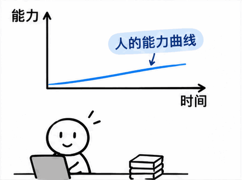

我们确实被加速了，甚至获得了红果短剧里主角般的待遇，有个系统了。
但是 Agent 如烈马，时常让人感觉无法驾驭。

## 二、分析跑完了，我却接不下去

- 让 Agent 跑完一次分析，得到脚本、结果表和几张图。
- 接下来想弄清某个结果，或者修改一个条件。
- 却要重新翻会话、找文件，还要解释自己指的是哪一版。
- 项目是自己的，自己却成了旁观者。


## 三、难在哪里

- 分析任务本身就复杂，Agent 又会产出大量脚本、表格和图。
- 中间可能还会产生大量决策需要我做，但是决策前置对用户来说并不友好，还没开始做的时候，做什么决定都不太稳妥的感觉。

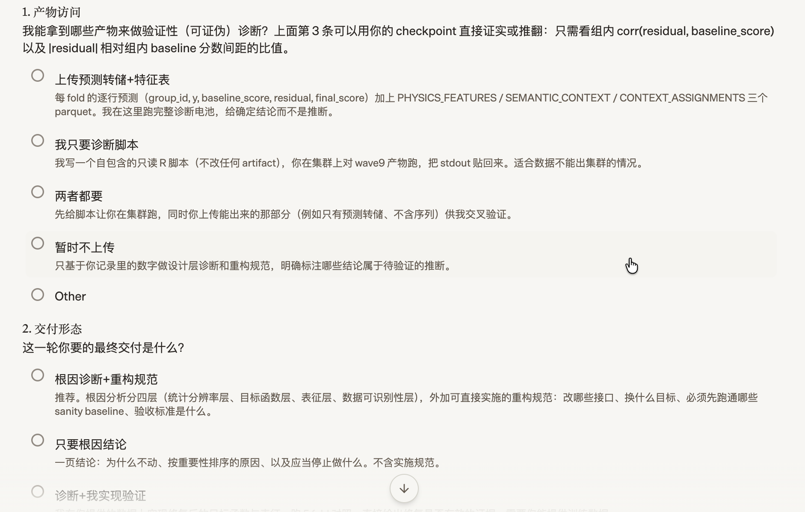

*截图来自一个自动化分析 Agent：Biomni 在任务开始前就需要大量决策。*

- 面对这些产物，我们真正想知道的是：
  - 这张图回答什么问题？
  - 用了哪些数据？
  - 为什么这样分析？
  - 哪些选择需要我来判断？
  - 改了条件后，结果有什么变化？

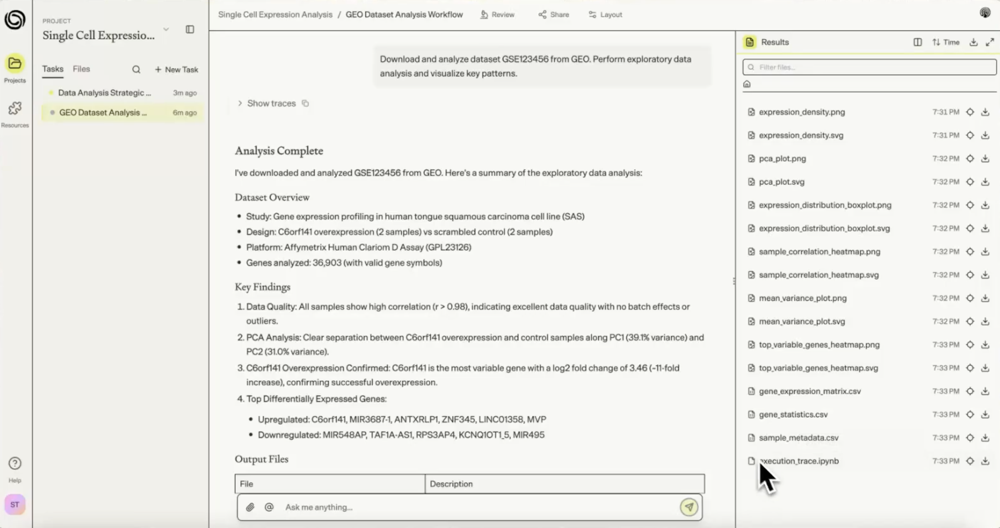

*截图来自一个自动化分析 Agent：Biomni 在任务结束后得到大量文件和结论。*

- 现状：代码挤在会话窗口里，文件散在各处。分散的脚本、文件和长会话，让梳理关系、确认要改的对象都变得费力。

总的来说，对话记录这种单一载体承载了太多：命令行、产物、决策，特别是 Agent 在开始前强迫用户做的决策、和 Agent 开始分析后偷偷为用户做的决策。一切都埋在了一个聊天记录里。

## 四、我希望 Agent 带我一起做

理想的合作方式应该是什么样的呢？

- **带我看懂：** 每个结果回答什么问题，来自哪些数据和步骤。
- **提示我判断：** 遇到关键选择，Agent 讲清选项和理由，请我决定。
- **让我接着改：** 我指着某个结果提要求，Agent 能准确接手。
- 一句话分工：**Agent 带路，决定权在你。**

## 五、Rho 是什么

- Rho 就是为解决这些问题而做的。
- 定义：**Rho 是一个让研究者与 AI Agent 共同工作的分析工作空间。你们可以围绕同一项目查看数据、编辑代码、运行分析，并针对具体结果继续讨论。**
- 不重新造一个 Agent：直接在你常用的 Agent 里使用 Rho，当然也可以在 Rho 里使用你喜欢的 Agent。
- 正如下面 Rho 的界面截图：
  1. 代码、数据表和图放在同一个工作空间里，执行记录也留在这里。
  2. Agent 可以把和当前问题相关的内容摆到你面前，带你看。
  3. 你可以选中某个结果追问或提出修改，Agent 带着对应的上下文继续工作。

Rho 没有固定的界面，从一张白纸开始。

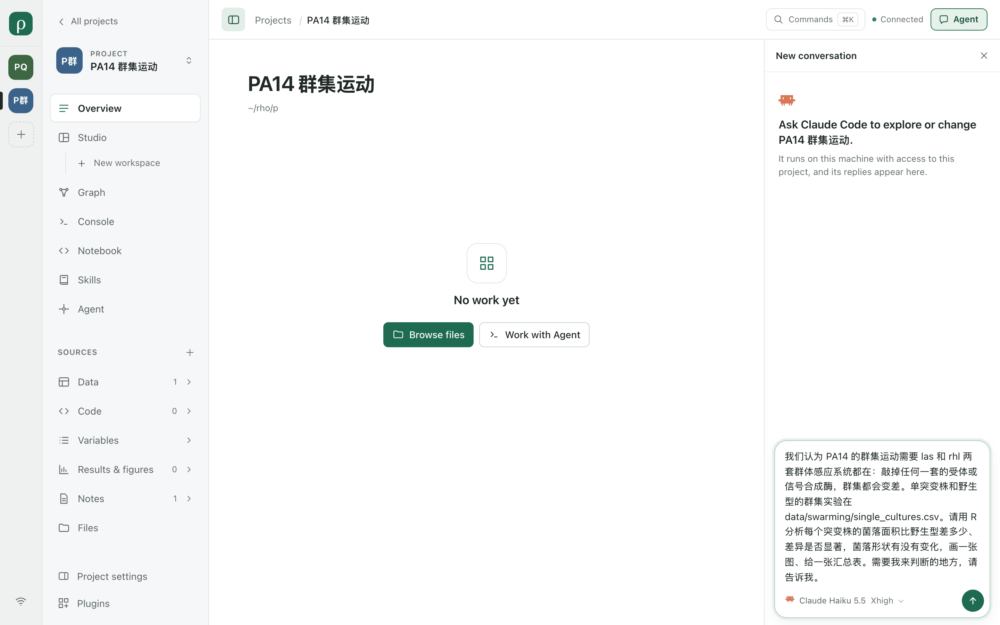

Agent 会边做边长出界面，这些界面你也可以参与编排和操作。

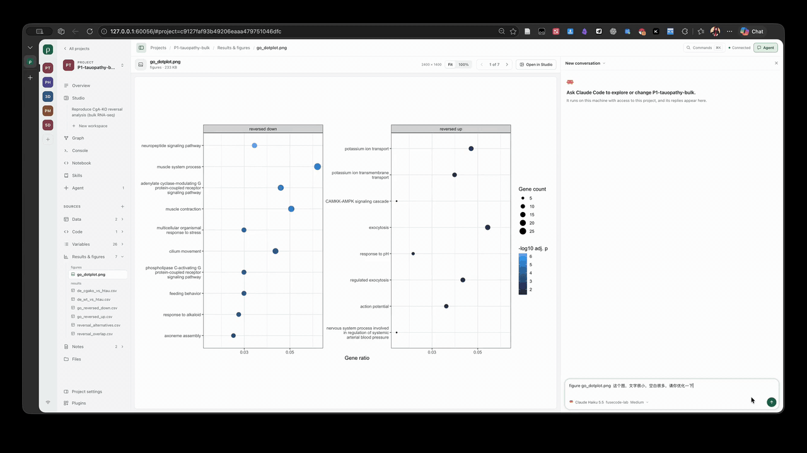

甚至亲自重新运行某段代码，更改某段文本，或者仅仅是对某个东西下达指令；时间轴播放按钮还能带你重新经历一次整个分析。

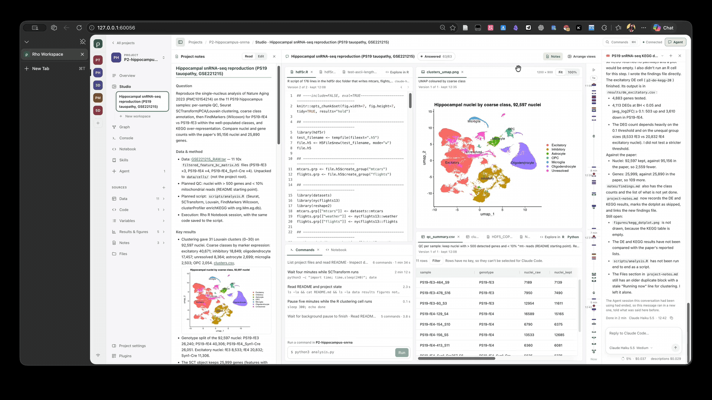

任务结束后的总结性界面。

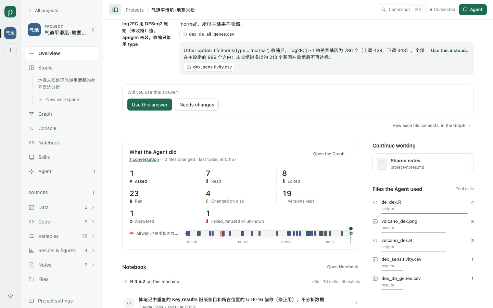

## 六、Rho 能做什么

首页那句 See what your Agent did，落到界面上是三类东西：Agent 和你**做了什么**、**做出了什么**、哪些**要你决定**。下面用一个小项目把 Rho 的功能走一遍。项目用的是经典的 airway 数据：4 个气道平滑肌细胞系，各有一份地塞米松处理和一份未处理的样本。

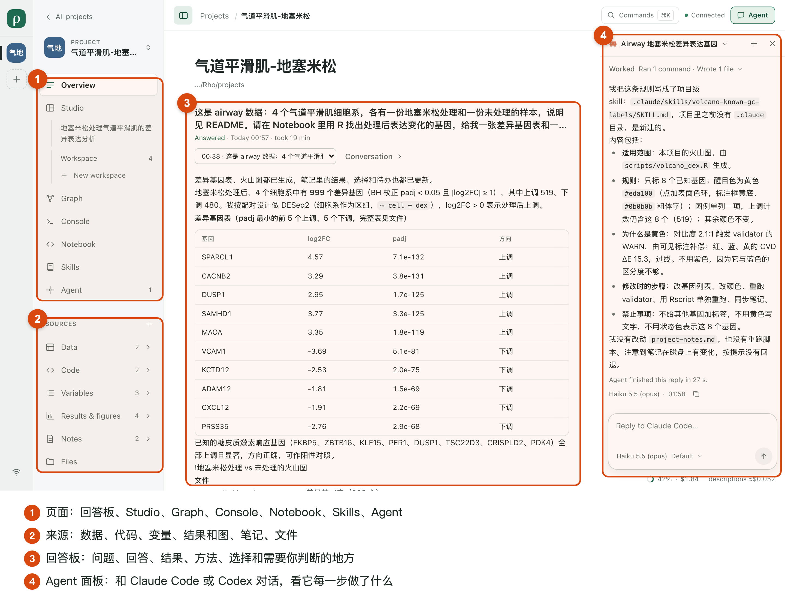

### 1. 做了什么：每一步都看得到

- **Agent 面板**：在 Rho 里直接和 Claude Code 或 Codex 对话。它读了什么、跑了什么命令、改了哪些文件，都一步步列出来，随时可以停。不管你在看哪一页，顶栏都显示它正在做什么。

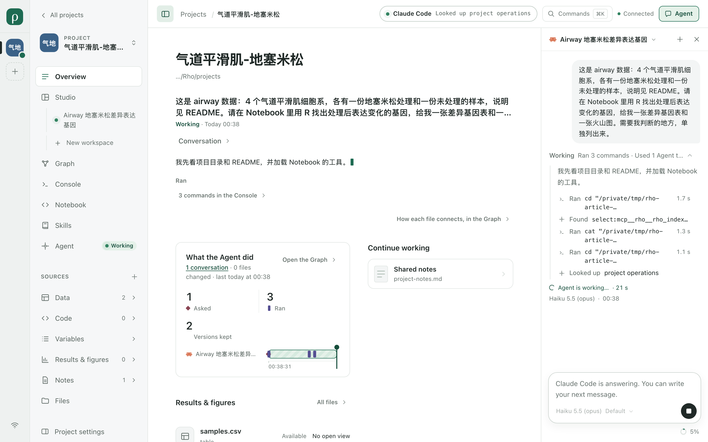

- **Console**：Agent 跑过的每条命令都在这里，写着为了什么、用了多久、改了哪些文件。你也可以在这里跑自己的命令。

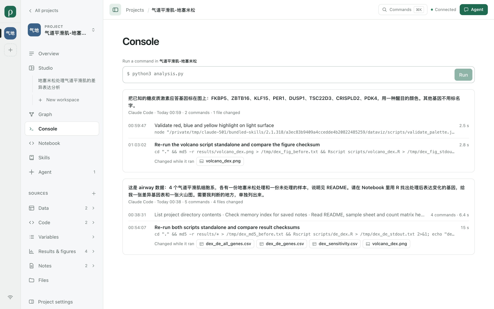

- **时间轴**：Graph 和 Studio 都有时间轴。可以按 1×、2×、4× 把整个分析回放一遍，也可以停在任何一刻。

### 2. 做出了什么：结果、来历和每一个版本

- **回答板**：每次回答摊在一页上。问题和回答在上面，主图主表在前，方法脚本、跑过的命令、读过的数据在后。

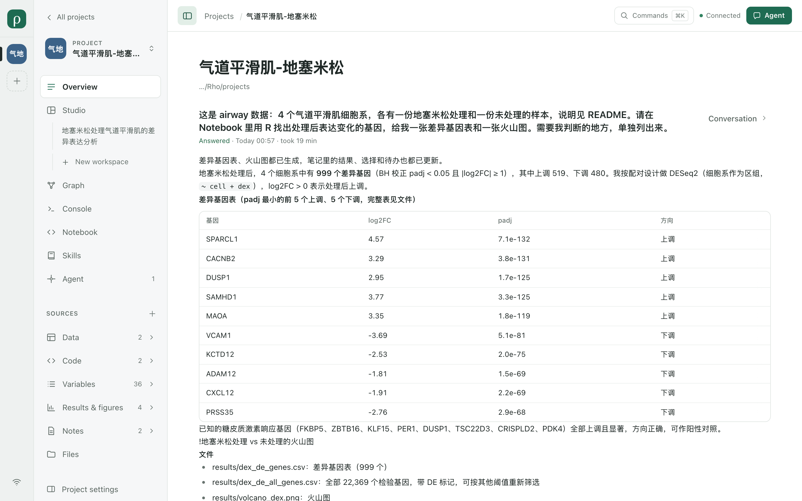

- **每一版都留着**：文件每变一次，Rho 都留下一版。火山图改过以后，点箭头就能回到上一版，整个工作区也跟着回到那一刻。

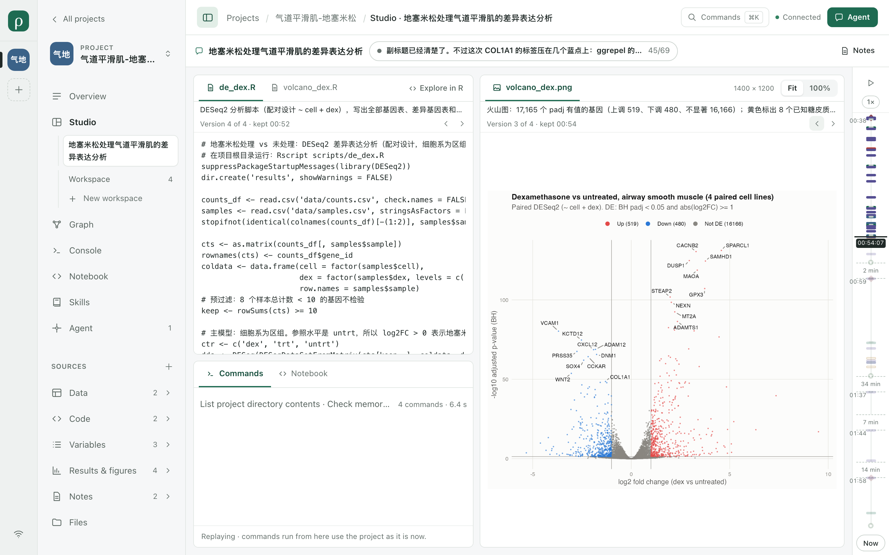

- **Graph**：把一次分析画成一张图。从问题出发，连到发现和选择，再连到它们依据的结果文件，最后是产生这些文件的脚本和命令。

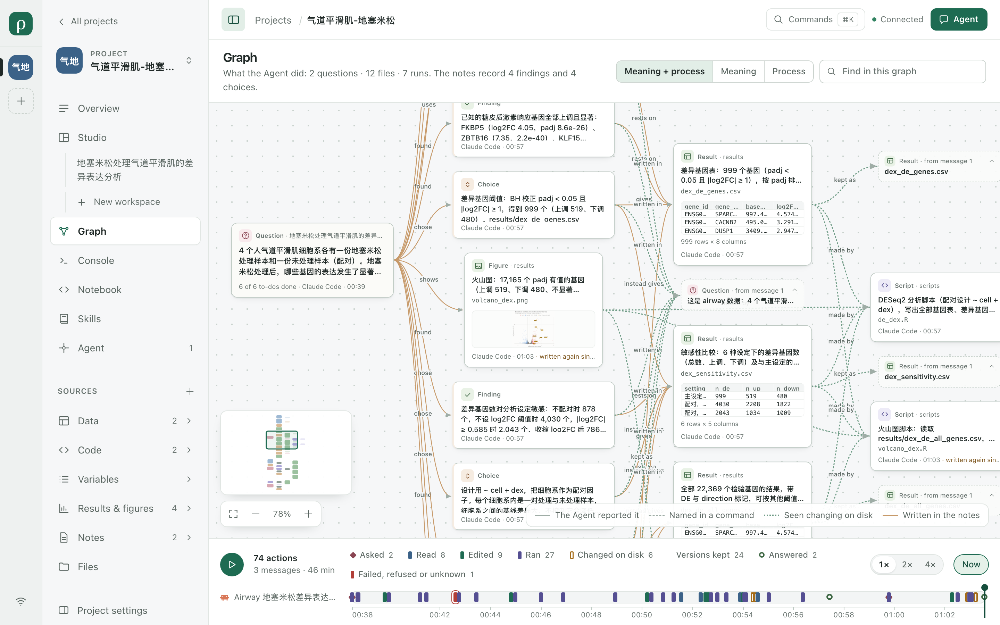

- **来源**：数据、代码、变量、结果和图、笔记按类型列在左边。点开就能看，用 ←、→ 逐个翻。

### 3. 要你决定的：摆在具体的地方

- **需要你判断的地方**：我在任务里加了一句“需要我判断的地方，单独列出来”，Agent 就在回答里列了 5 条：阈值、是否配对、log2FC 是否收缩、图上标哪些基因、重名的基因名。和开工前就逼你做的决定不同，这时手里已经有结果可以参考。

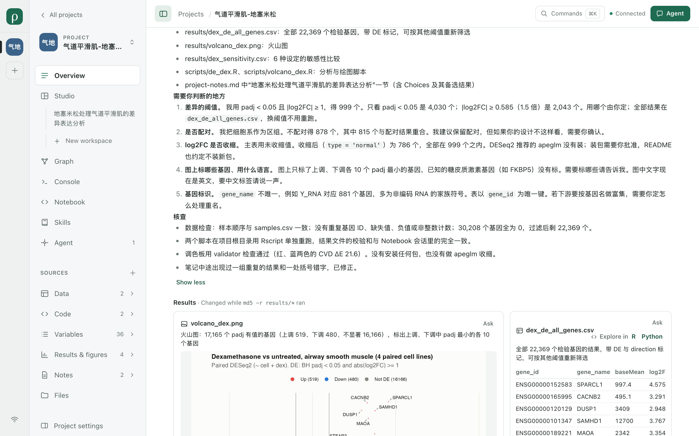

- **关键选择和另一种做法**：回答板下面列出 Agent 的关键选择，写明用了哪种做法、换一种会得到什么。比如不配对得 878 个差异基因，配对得 999 个。点 “Use this instead…”，Rho 会替你写好一条消息，你改好再发给 Agent。

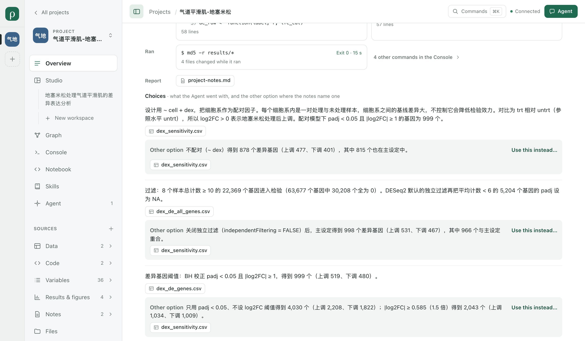

- **指着结果说话**：每个结果都有 Ask，在回答里选中一段话也能 Ask about this。消息会带上你指的那个文件、那一版，不用再解释“我说的是哪张图”。

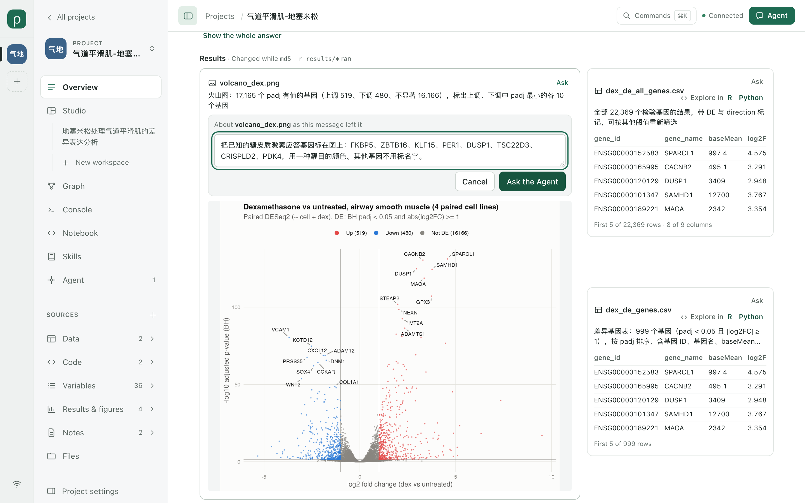

- **记下决定**：看完回答，点 “Use this answer” 或 “Needs changes”。Rho 记下你的决定，以及它对应的是哪些文件版本。

- **把做法留下来**：

  - 共享笔记 project-notes.md 里，Agent 为每个任务写一节：问题、数据和方法、关键结果、选择、待办。你可以直接改。
  - Skills 记的是这个项目的做事方法。我让 Agent “把标注规则记成这个项目的 Skill”，27 秒后 Skills 页上就有了它，以后在这个项目里工作的 Agent 都会读到。

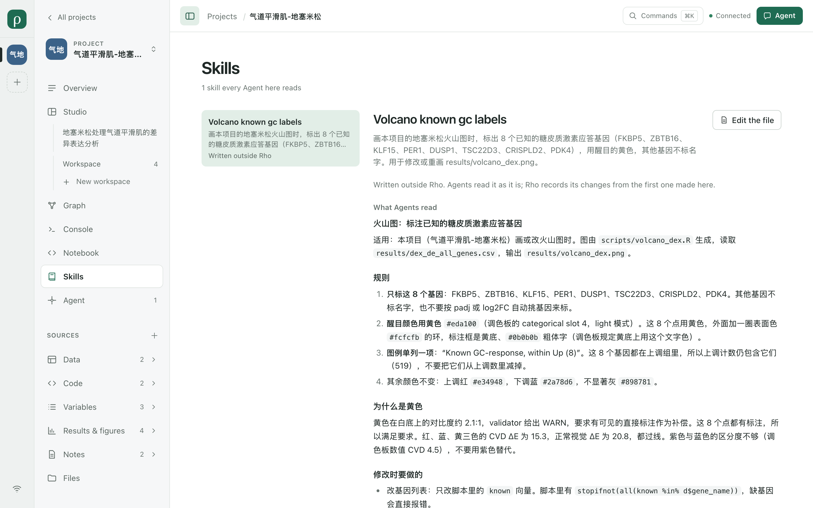

### 4. 一起动手，一起编排

- **共用一个 R / Python 会话**：Agent 在 Notebook 里跑过的代码，你可以在同一个会话里接着跑。每个单元格都标着是谁跑的、为了什么。在表格上点 Explore in R，这张表就读进了会话。变量、图和 Data flow（每个值从哪个文件、哪个单元格来）可以并排看。

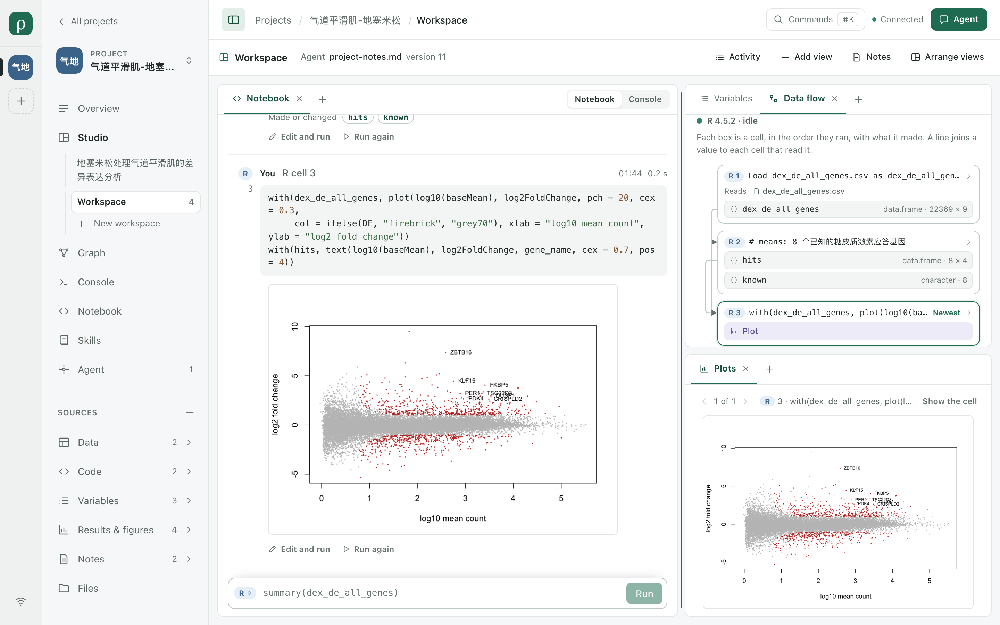

- **Studio**：Agent 把一次对话用到的脚本、图、表、命令按角色摆好。你可以拖动、分屏、加视图，也可以新建自己的工作区。

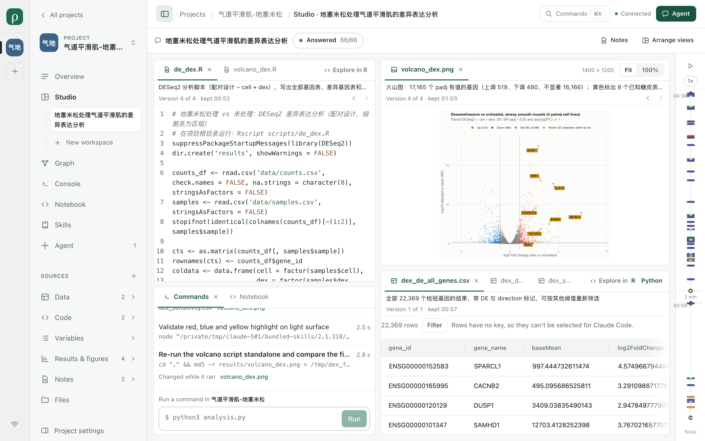

- **插件**：表格、图、文档、Notebook、Console、Skills，这些视图各由一个插件提供，目前装了 12 个。

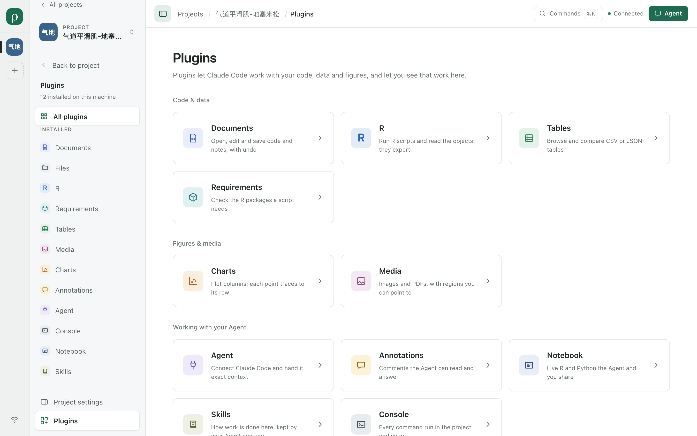

### 5. 用你自己的 Agent

- Rho 不重新造 Agent。在 Rho 里用的就是你自己的 Claude Code 或 Codex，模型在 Agent 页选。

- 也可以反过来，在 Agent 页点一下，把 Rho 加进你终端里的 Claude Code 或 Codex。它在终端里照常工作，做的事会显示在 Rho 里。

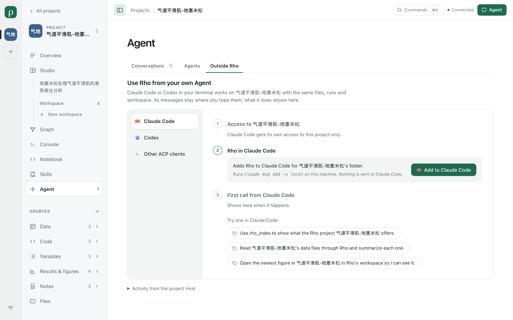

- 对话列表记着每个对话用的模型、上下文用量和花费。你可以接着聊，也可以导出成 Markdown。

## 七、怎样开始

我们已经准备了一个供 Agent 使用的 Rho Skill，指导你的 Agent 完成 Rho 的安装，并在后续分析中使用 Rho。

提示词：

```text
请阅读 https://yulab-smu.top/Rho/doc/setup.md 文档，按照步骤为我安装并配置 Rho。
```

## 八、目前做到哪里

- 支持范围：在 Agent 工作流中自然运行，可以用浏览器打开交互式工作空间；可直接对产物进行工作台式操作，比如编辑 Markdown、编辑和运行 Agent 产生的 R 和 Python 分析；交互式工作空间也能启动 Agent 聊天框。
- 项目地址：[github.com/YuLab-SMU/Rho](https://github.com/YuLab-SMU/Rho)
- 在线演示：[yulab-smu.top/Rho](https://yulab-smu.top/Rho/)（在示例项目上回放一次真实会话，不用安装就能看到界面）
- 反馈入口：[github.com/YuLab-SMU/Rho/issues](https://github.com/YuLab-SMU/Rho/issues)


## 九、结尾

- 有了 Rho，你不必再为 Agent 产生的一堆东西手忙脚乱。
- 做完一轮分析，你也更懂这份分析，还能继续做、跟着做，重复做。
- 你可以从「AI 给我做」，到「AI 带我一起做」。
